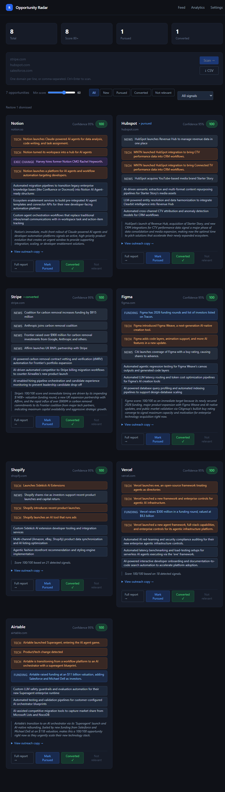
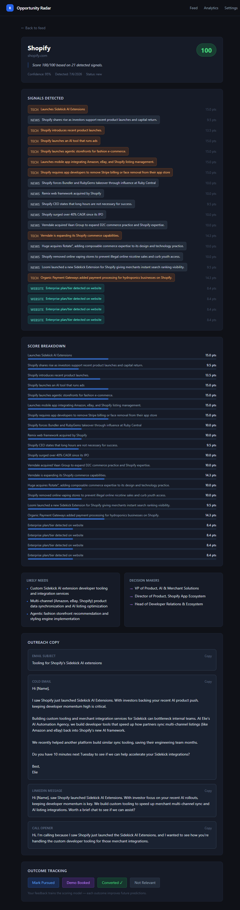
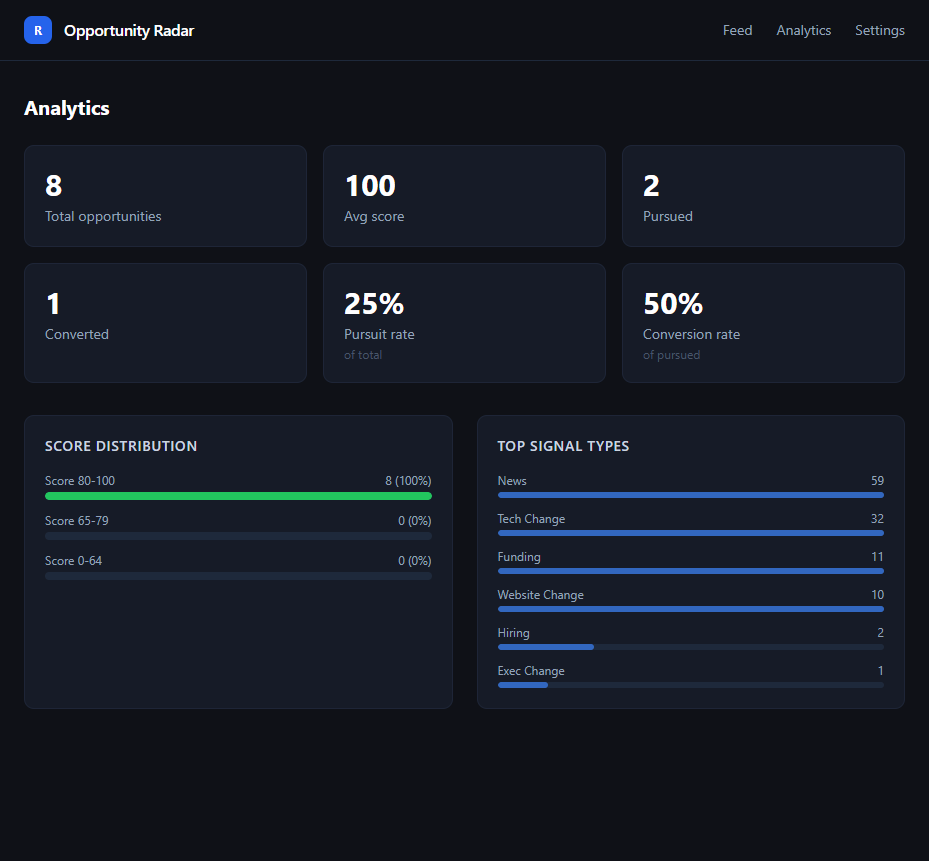

# AI Opportunity Radar

**Multi-agent B2B buying-intent detection.** Five AI agents watch the public
signal exhaust of target companies — funding rounds, hiring sprees, exec
changes, tech-stack shifts, website updates — score each company 0–100 on
purchase readiness, and draft the first outreach message. A learning agent
re-weights the scoring formula weekly from real conversion outcomes.

> Kaggle *AI Agents: Intensive Vibe Coding* capstone — **Agents for Business** track.
> Demo video: https://youtu.be/sduB3Nol7pM



## The problem

Companies never announce "we're ready to buy AI automation." But they leak
the signal constantly: a funding round closes, a first Head of Operations is
hired, five support roles get posted in a month. By the time a company
publicly asks for help, ten agencies are already competing on price. Catching
the intent early means manually monitoring news, job boards, and prospect
websites across dozens of accounts — which nobody does consistently. That
research grind is a perfect job for agents.

## Architecture — five agents in a pipeline

```
Signal sources (Crunchbase RSS · news feeds · Indeed RSS · Apify/LinkedIn · website-diff monitor)
        │
        ▼
SignalCollectionAgent   LLM turns raw articles/job posts into structured signals
        │                (type, entity, date, confidence, evidence)
        ▼
ScoringAgent            deterministic — NOT an LLM:
        │                score = Σ(weight × recency × confidence) × company_fit
        ▼
IntelligenceAgent       LLM reasons over the signal history → "why now",
        │                likely needs, decision-maker titles
        ▼
OutreachAgent           LLM writes cold email + LinkedIn message + call opener,
        │                grounded in the actual signals and the agency's specialty
        ▼
Supabase (PostgreSQL)   long-term memory: signals, scores, copy, feedback, weights
        │
        ├── FastAPI backend        scan triggers · opportunity feed · feedback · Stripe
        ├── Next.js dashboard      feed, full reports, analytics, outcome buttons
        ├── MCP server             the same pipeline as Model Context Protocol tools
        └── APScheduler            daily scans · Monday digests · Sunday learning cycle
                                          │
                                          ▼
LearningAgent (weekly)  re-derives signal weights from recorded outcomes
                         (pursued / demo booked / converted / not relevant)
```

Design principle: **LLMs where judgment is needed, deterministic code where
trust is needed.** Scoring — the decision the product hangs on — is a
transparent formula that can be recomputed for free when the LearningAgent
updates weights. Every LLM call returns schema-validated JSON (with
markdown-fence stripping and balanced-block extraction); the pipeline never
parses prose, and a circuit breaker keeps a failing provider from stalling it.



## The LLM router — Claude API or a local CLI agent, no code changes

All five agents talk to one router (`llm/claude_router.py`) with three verbs:
`extract` (high-volume structuring), `analyze` (reasoning), `compose`
(writing).

| Provider | When | Models |
|---|---|---|
| Anthropic API | `ANTHROPIC_API_KEY` set | Haiku for extract, Sonnet for analyze/compose |
| **Gemini CLI / Antigravity (`agy`)** | no API key at all | the locally installed CLI runs each call in `--print` mode (`llm/agy_provider.py`) |

The CLI backend required real systems work: the CLI blocks forever on a piped
stdin, and hangs in its shutdown phase after printing the answer. The provider
detaches stdin, watches stdout until it stabilizes, then reaps the process.
`GET /health` reports which provider is live. Force one with
`LLM_PROVIDER=anthropic|agy`.

## MCP server

`mcp_server.py` exposes the whole pipeline as Model Context Protocol tools, so
any MCP client (Claude Desktop, Claude Code, Gemini CLI, other agents) can
drive the radar: `scan_domains`, `scan_status`, `list_opportunities`,
`get_opportunity`, `record_feedback`. It authenticates through the same
per-customer API-key layer as the dashboard.

```bash
# backend must be running (python start.py), then e.g. with Claude Code:
claude mcp add opportunity-radar -e RADAR_API_KEY=radar_... -- python mcp_server.py
```

## Quick start

Prereqs: Python 3.11+, Node 18+, a free [Supabase](https://supabase.com) project,
and either an Anthropic API key **or** the [Antigravity CLI](https://antigravity.google) (`agy`) installed.

### 1. Database

Run `db/schema.sql` in the Supabase SQL editor (creates all tables and seeds
the default signal weights), then `db/migration_002_schema_hardening.sql`.

### 2. Backend

```bash
cp .env.example .env          # fill in SUPABASE_URL + SUPABASE_KEY (+ optional keys)
pip install -r requirements.txt
python start.py               # API on :8000 + background scheduler

# or a CLI one-shot scan:
python main.py --domains acme.com,foocorp.io --min-score 65
```

Create an account and grab your API key (shown once):

```bash
curl -X POST localhost:8000/customers/signup -H "Content-Type: application/json" \
  -d '{"agency_name":"My Agency","email":"me@example.com","agency_specialty":"AI automation for B2B"}'
```

### 3. Frontend

```bash
cd frontend
cp .env.local.example .env.local   # NEXT_PUBLIC_API_URL=http://localhost:8000
npm install && npm run dev         # open http://localhost:3000
```

Paste your `radar_...` key in **Settings**, then scan a domain from the feed.
A scan takes ~2–5 minutes (longer on the CLI backend, which serializes calls).

### 4. Tests

```bash
python -m pytest tests/    # 16 tests: scoring math, learning loop, scrapers
```

## Environment variables

See `.env.example` for the annotated list. Required: `SUPABASE_URL`,
`SUPABASE_KEY`, and an LLM provider (Anthropic key or the `agy` CLI).
Optional: `BING_API_KEY`, `APIFY_TOKEN`, `APOLLO_API_KEY`, SMTP creds for
email digests, and `STRIPE_*` for billing. **No secrets are committed to this
repo — everything flows through `.env`, which is gitignored.**

## API endpoints

```
POST  /customers/signup            create account → API key (hash stored, shown once)
GET   /customers/me                profile        PATCH /customers/me  update
POST  /customers/checkout          Stripe checkout URL for plan upgrade

POST  /scan                        async scan of up to 20 domains
GET   /scan/status/{id}            scan progress
GET   /opportunities               ?min_score=&status=&limit=&offset=
GET   /opportunities/{id}          full report + outreach copy
POST  /opportunities/{id}/feedback record outcome (the data-moat endpoint)

POST  /webhooks/stripe             Stripe webhook receiver
GET   /health                      status + active llm_provider
```

Auth: `X-API-Key: radar_...` or `Authorization: Bearer radar_...`.

## Security

- API keys are generated server-side, stored **hashed** (SHA-256), and shown
  exactly once at signup.
- Every data route is scoped to the authenticated customer (`customer_id`
  filter on opportunities/feedback); customers cannot see each other's data.
- No credentials in code or git history; `.env` is gitignored and
  `.env.example` documents every variable.
- Outreach is **drafted, never auto-sent** — a human reviews and sends.
- Optional Postgres row-level-security policies ship in
  `db/migration_002_schema_hardening.sql` for service-role deployments.

## Scoring formula

```
score = Σ(signal_weight × recency_multiplier × confidence) × company_fit_multiplier
```

Normalised 0–100. Recency decay: 1.0 (≤7d) → 0.85 (≤14d) → 0.65 (≤30d) →
0.40 (≤60d) → 0.15 (older). Company-fit multiplier 0.5–1.5 from employee
count, business model, industry, and tech stack. Weights live in the
`signal_weights` table and are updated by the LearningAgent.



## Autonomous schedules

| Schedule | Job |
|---|---|
| Daily 6 AM UTC | Scan all domains in `WATCHLIST_DOMAINS` |
| Monday 8 AM UTC | Email digest to all active customers |
| Sunday 3 AM UTC | Learning cycle — re-weight signals from feedback |

## Business model

Multi-tenant SaaS with Stripe subscriptions: Pilot $497/mo (10 opportunities/
week), Growth $997/mo (25), Scale $1,997/mo (unlimited). The feedback data is
the moat — every customer's conversion outcomes calibrate their instance's
scoring to what actually closes for them.

## Deployment notes

The stack is a standard three-piece deployment: the FastAPI app (`start.py`)
runs anywhere Python runs (a VM, Fly.io, Railway — bind `0.0.0.0:8000`), the
Next.js frontend deploys to Vercel with `NEXT_PUBLIC_API_URL` pointed at the
API, and Supabase is already managed. The scheduler runs inside the API
process, so a single backend instance is the whole control plane. For the
Anthropic-less mode, the `agy` CLI must be installed on the host and logged in.
